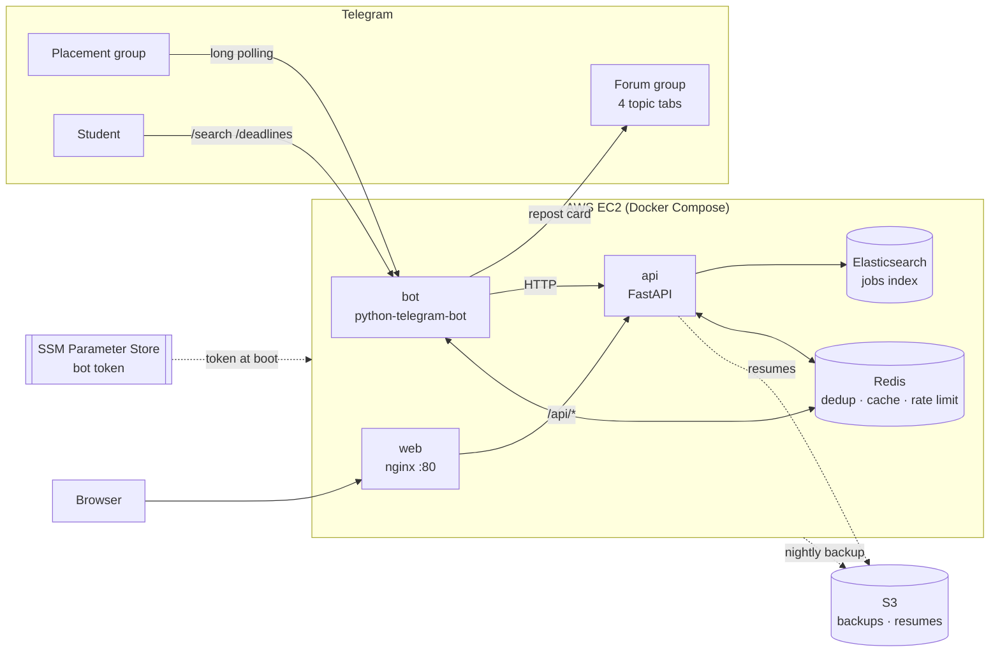
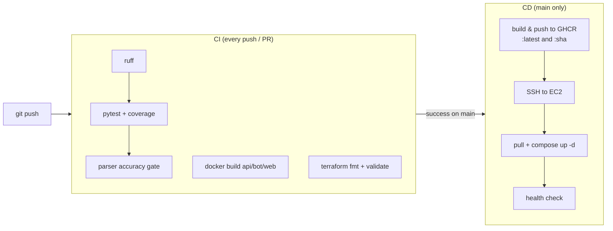

# PlacementHub

[](https://github.com/kammala-kalyan/placementhub/actions/workflows/ci.yml)
[](https://github.com/kammala-kalyan/placementhub/actions/workflows/cd.yml)

PlacementHub collects campus placement messages from Telegram groups, extracts
structured fields, removes duplicates, and lets students search and filter
openings through a Telegram bot and a small web UI. It runs as five Docker
containers, deploys to AWS with Terraform, and is tested and shipped by
GitHub Actions, with a nightly Jenkins pipeline for maintenance.

## Problem

Students receive hundreds of unstructured placement messages in Telegram
groups. The same opening is forwarded many times, nothing is searchable, and
students miss deadlines. PlacementHub turns each message into a structured job
(company, role, CTC/stipend, location, eligibility, deadline, apply link),
keeps exactly one copy, and makes every opening searchable in seconds.

## Architecture



Only nginx (port 80) is public. Elasticsearch, Redis and the API are reachable
only inside the server. The bot never touches Elasticsearch: every write goes
through `POST /ingest`, so parsing, dedup and caching live in one place.

## Features

- **Telegram bot**: reads placement groups, sorts each message into
  Full-time / Internship / Hackathon / Other and reposts a clean card into the
  matching forum topic. Commands: `/search`, `/latest`, `/deadlines` (closing
  within 3 days), `/filter role= location= category=`, `/help`.
- **Parser**: regex + rules extract company, role, CTC (`6-8 LPA`,
  `Rs 6,00,000 p.a.`), stipend (`30k/month`), location, branches, CGPA, batch,
  deadline (4 date formats) and apply link. Pluggable `Parser` interface for a
  future LLM parser.
- **Search**: Elasticsearch full-text search with typo tolerance (fuzziness),
  filters (category, role, location, deadline range), sort by relevance or
  deadline.
- **Redis**: duplicate detection, 60-second search cache, per-user bot rate
  limit. If Redis is down the app keeps working (degraded, logged, counted).
- **Web UI**: search box, filters, job cards with red/amber deadline
  highlighting, health indicator.
- **Resume Match**: upload a resume, see jobs where you already have at least
  70% of the required skills, with missing skills listed. Skills are only
  taken from your own file, never invented.
- **Observability**: JSON logs, `/health` (checks Elasticsearch and Redis),
  `/metrics` in Prometheus format.

## Tech stack and why

| Tool | Why this tool |
|---|---|
| **Python 3.12 + FastAPI** | Type-checked request/response models with Pydantic and free OpenAPI docs at `/docs`. |
| **python-telegram-bot** | Mature async library; long polling needs no domain or open port. |
| **Elasticsearch 8** | Real full-text search: relevance ranking, typo tolerance and fast filters that SQL `LIKE '%x%'` cannot do. Heap capped at 512 MB. |
| **Redis 7** | In-memory and atomic (`SET NX`, `INCR`), ideal for dedup, short-lived cache and rate limiting. Not the source of truth. |
| **nginx** | Serves static files and reverse-proxies the API, hiding internal ports. |
| **Docker + Compose** | Same images on a laptop and on EC2; one command starts all five services. Multi-stage, slim, non-root images with healthchecks. |
| **Terraform** | Infrastructure as Code: the whole AWS setup is reviewed, versioned and recreated with `apply`, removed with `destroy`. |
| **AWS (EC2, S3, IAM, SSM, Budgets)** | Free-plan friendly building blocks; an IAM role instead of access keys, secrets in SSM. |
| **GitHub Actions** | CI on every push and CD to EC2, defined next to the code, free for public repos. |
| **Jenkins** | Scheduled maintenance jobs (accuracy check, re-index, backups), configured as code. |
| **pytest, fakeredis, ruff** | Fast tests without real services or secrets; consistent linting. |

## Repository layout

```
api/                 FastAPI service (Dockerfile, app/)
bot/                 Telegram bot (Dockerfile, long polling)
parser/              Shared parser: interface, rule-based parser, skills
web/                 Static UI + nginx config (Dockerfile)
scripts/             Seed data, seed, accuracy report, re-index, backup, deploy
tests/               192 tests (fakes and mocks, no real services)
infra/terraform/     AWS infrastructure as code
.github/workflows/   ci.yml and cd.yml
jenkins/             Jenkins as code + Jenkinsfile
docs/                Design, deployment, Jenkins, interview notes, demo script
```

## Run locally

Requirements: Docker Desktop, Python 3.12+ (for the seed script and tests).

```bash
cp .env.example .env              # Windows: Copy-Item .env.example .env
docker compose up -d --build      # elasticsearch, redis, api, bot, web
docker compose ps                 # wait until everything is "healthy"
python -m scripts.seed            # 50 sample messages: 47 created, 3 duplicates
```

Open:
- Web UI: <http://localhost> (set `WEB_PORT=8080` in `.env` if port 80 is busy)
- API docs: <http://localhost/docs>
- Health: <http://localhost/api/health>

The bot needs a token from @BotFather in `.env` (see the comments in
`.env.example`); without one it stays idle and the rest of the stack works.

### Tests (no Docker needed)

```bash
python -m venv .venv
.venv/bin/pip install -r requirements-dev.txt    # Windows: .venv\Scripts\pip
.venv/bin/ruff check .
.venv/bin/pytest --cov=app --cov=bot --cov=parser
.venv/bin/python -m scripts.parser_accuracy      # per-field accuracy table
```

## Deploy to AWS

Full walkthrough (account, Free plan, IAM user, AWS CLI, SSH key, apply,
verify, destroy): **[docs/DEPLOYMENT.md](docs/DEPLOYMENT.md)**.

```bash
cd infra/terraform
cp terraform.tfvars.example terraform.tfvars   # fill in your values
terraform init && terraform plan && terraform apply
terraform output web_url
```

Terraform creates: security group (80 public, 22 key-only), one EC2 instance
(`t3.micro` default, `t3.small` for demos) with IMDSv2 and an encrypted disk,
a private versioned S3 bucket, a least-privilege IAM role, the bot token as an
SSM SecureString, and a $5 AWS Budget alert. The first-boot script adds swap,
installs Docker and starts the stack.

## CI/CD



- **CI** (`.github/workflows/ci.yml`) needs no secrets: tests use fakes, images
  are built but not pushed, Terraform is only validated.
- **CD** (`.github/workflows/cd.yml`) starts only after CI succeeds on `main`.
  Images are tagged with the commit SHA, so every deploy is traceable and any
  earlier version can be redeployed. Secrets: `EC2_HOST`, `EC2_SSH_KEY`.
- **Jenkins** (`jenkins/`) runs nightly: parser accuracy gate, zero-downtime
  re-index (new index + atomic alias swap), backup to S3.
  See [docs/JENKINS.md](docs/JENKINS.md).

## Observability

- Structured JSON logs from every service (one object per line, easy to query
  in CloudWatch Logs), rotated at 10 MB x 3 per container.
- `GET /health`: `ok`, `degraded` (Redis down, app still works) or `down`
  (Elasticsearch down, HTTP 503). Used by Docker healthchecks and CD.
- `GET /metrics`: request counts and latency histograms, ingest results,
  cache hits/misses, dedup checks, Redis errors. Blocked from the internet by
  nginx; scrape it from inside the server.

## Cost safety

- AWS Free plan only: no NAT gateway, load balancer, RDS, managed OpenSearch
  or Elastic IP. Default VPC, one small instance.
- `cpu_credits = "standard"` (no CPU burst charges), 20 GB disk (Free Tier
  includes 30 GB), S3 lifecycle rules delete old versions, backups and resumes.
- A $5 AWS Budget emails you at 80% actual and 100% forecast.
- **Run `terraform destroy` after every demo.** A running instance and its
  public IPv4 address cost money once Free Tier credits are used up.

## Security notes

- No secrets in the code or Git history: `.env`, `terraform.tfvars` and state
  files are ignored; the bot token lives in SSM and is read at boot via the
  instance role; CI/CD secrets live in GitHub Secrets.
- Containers run as non-root users; only port 80 (and key-only SSH) is open.
- Least-privilege IAM: one bucket (no delete), one SSM parameter.
- User content is escaped everywhere it is displayed (bot HTML and web UI).

## Screenshots

| Web UI search | Telegram `/deadlines` | Resume Match |
|---|---|---|
| _screenshot: docs/screenshots/web-search.png_ | _screenshot: docs/screenshots/bot-deadlines.png_ | _screenshot: docs/screenshots/resume-match.png_ |

| GitHub Actions CI/CD | Jenkins pipeline | Terraform apply |
|---|---|---|
| _screenshot: docs/screenshots/actions.png_ | _screenshot: docs/screenshots/jenkins.png_ | _screenshot: docs/screenshots/terraform.png_ |

## Known limitations

- Parser accuracy is 100% on the 47 labelled sample messages, which were
  written alongside the parser. Real messages are messier; the nightly
  accuracy job exists to catch regressions as new labelled samples are added.
- Single EC2 instance: no high availability. Fine for a campus-scale demo.
- Scanned (image-only) resume PDFs are not supported (no OCR).

## Future improvements

- LLM parser behind the existing `Parser` interface, used only when rules are
  unsure (with the rule parser as fallback).
- HTTPS with a domain and Let's Encrypt; CD via SSM Run Command with GitHub
  OIDC instead of SSH (no open port 22, no stored keys).
- Prometheus + Grafana containers and alerting; CloudWatch Logs shipping.
- Deadline reminder notifications from the bot; per-student saved searches.
- Run on Kubernetes (k3s) with Helm for multi-instance scaling.
