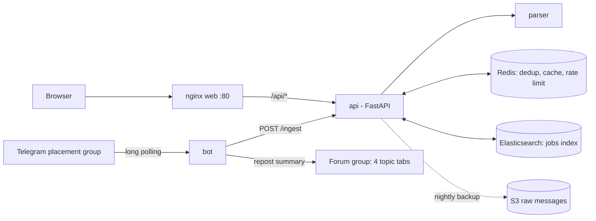

# PlacementHub – Design (approved in Phase 0)

## Problem
Students receive hundreds of unstructured placement messages in Telegram groups.
They are duplicated, unsearchable, and students miss deadlines. PlacementHub
collects these messages, extracts structured fields, removes duplicates, and lets
students search and filter openings through a Telegram bot and a small web UI.

## Architecture

- Only nginx (port 80) is public. Elasticsearch, Redis and the API live on the
  internal Docker network.
- The bot never talks to Elasticsearch; it calls the API. One write path.

## Decisions

| Topic | Decision |
|---|---|
| Categories | Full-time, Internship, Hackathon, Other. Role is a separate field. |
| Bot output | Store every message and repost a structured card to the matching forum topic. |
| Bot mode | Long polling (no domain, TLS or inbound port needed). |
| AWS region | ap-south-1 (Mumbai) |
| Python | 3.12, requirements.txt per service |
| Seed data | ~50 fictional-company messages, labelled for accuracy tests |
| EC2 memory | t3.micro default + 2 GB swap + ES heap by variable; t3.small for demos |
| CD access | SSH, port 22 open, key-only auth (SSM + OIDC noted as upgrade) |
| Phase 9 | Decide after Phase 8; `skills` field and `resumes/` S3 prefix reserved |

## Data design

### Elasticsearch 8 (single node, security off, internal only)
- Index `jobs_v1` behind alias `jobs` (zero-downtime re-index by moving the alias).
- Mapping: `company`, `role`, `location` as text + keyword; `raw_text` (english
  analyzer); `category`, `branches`, `skills` keyword; `batch` integer;
  `ctc_lpa`, `cgpa_min` float; `stipend_month` integer; `deadline`, `posted_at` date.
- Search: `multi_match` with `fuzziness: AUTO`, company/role boosted; filters in
  `bool.filter`; sort by relevance or deadline.

### Redis 7
- **Dedup**: SHA-256 of normalized text. The same hash is the ES document `_id`
  and is indexed with `op_type=create`, so duplicates are blocked even if Redis is down.
- **Search cache**: key = hash of query params, TTL 60 s.
- **Rate limit**: fixed window per user per minute (bot commands).
- **Degradation**: every Redis call is wrapped; failures are logged and counted
  in `placementhub_redis_errors_total`, and the app keeps working.

## API
`POST /ingest`, `GET /jobs/search`, `GET /jobs/latest`, `GET /jobs/{id}`,
`GET /jobs/deadlines`, `GET /health`, `GET /metrics`, OpenAPI docs at `/docs`.

## Cost rules
AWS Free plan only. No NAT gateway, load balancer, managed OpenSearch, RDS or
unattached Elastic IP. `terraform destroy` after every demo.
